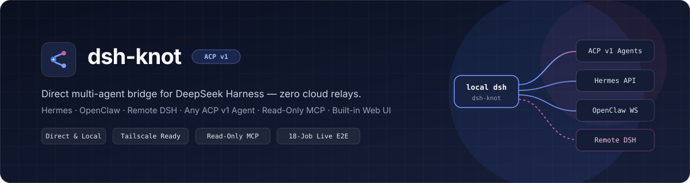
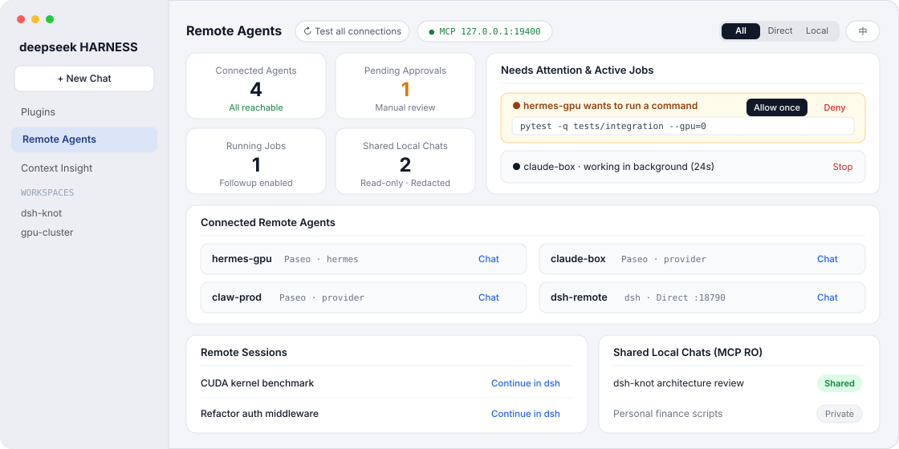

<p align="center">
  
</p>

<p align="center">
  <a href="https://github.com/Weaxs/dsh-knot/actions/workflows/ci.yml">
    
  </a>
  <a href="https://github.com/Weaxs/dsh-knot/actions/workflows/e2e.yml">
    
  </a>
  <a href="https://www.npmjs.com/package/@weaxs/dsh-knot">
    
  </a>
  = 22.13" />
  
  <a href="LICENSE">
    
  </a>
</p>

<p align="center">
  Connect <strong>DeepSeek Harness (dsh)</strong> directly with <strong>ACP v1 agents</strong>, <strong>Hermes</strong>, <strong>OpenClaw</strong>, and remote <strong>dsh</strong> instances on the same host or over a private network, with a built-in dsh Web UI and read-only MCP session sharing. <strong>No cloud relay, no broker, and no remote plugin required.</strong>
</p>

---

## Highlights

| Capability                   | What you get                                                                                                                                                                                              |
| ---------------------------- | --------------------------------------------------------------------------------------------------------------------------------------------------------------------------------------------------------- |
| **Universal ACP v1**         | Connect to an ACP v1 WebSocket endpoint or launch a local NDJSON stdio agent.                                                                                                                             |
| **Native Drivers**           | First-class native adapters for **Hermes** (`/v1/runs` + SSE), **OpenClaw** (Gateway WebSocket v4 + Ed25519 pairing), and **remote dsh** (`/api/session/*` RPC), plus the optional `dsh-knot-acp` bridge. |
| **Built-in dsh Web UI**      | Chat with remote agents, browse sessions, review approvals, cancel jobs, test connections, and manage read-only MCP sharing.                                                                              |
| **Zero-Config GUI Settings** | Exports a `@deepseek-ai/schemastery` Config schema so `dsh Settings → Plugins` renders a visual form automatically.                                                                                       |
| **Read-Only MCP Export**     | Expose explicitly allow-listed local dsh sessions to remote agents on a separate loopback/tailnet port with deny-by-default access, constant-time bearer auth, and recursive secret redaction.            |
| **Live E2E**                 | 18-job real model-backed E2E matrix across Local, Tailscale, and Headscale.                                                                                                                               |

---

## Web UI Dashboard

When loaded in `dsh web`, **dsh-knot** registers the **Remote Agents / 远端助手** sidebar entry:

<p align="center">
  
</p>

- **Approve or cancel in one click**: Remote approval prompts and active background jobs appear at the top of the panel.
- **Inspect connections**: Run `knot_doctor` across all configured agents or expand per-agent gateway checks.
- Click **Chat** on an assistant to open its conversation view. Expand **Thinking** or **Activity** when the agent reports reasoning or tool activity. Reopen a remote session to continue it. Hermes loads recent messages directly from its API server. To display reasoning from OpenClaw, enable reasoning visibility for the session. [OpenClaw reasoning settings](https://docs.openclaw.ai/tools/thinking#reasoning-visibility-reasoning)
- **Control local sharing**: Toggle which local dsh sessions are visible over the separate read-only MCP listener.

---

## Architecture

<p align="center">
  
</p>

See [docs/DESIGN.md](docs/DESIGN.md) for protocol contracts, event normalization, and security boundaries.

---

## Install

Both npm package names ship identical builds: **`@weaxs/dsh-knot`** and **`dsh-knot`**.

### From npm inside DeepSeek Harness

```text
Plugins → Add plugin → npm → @weaxs/dsh-knot
```

### From a local checkout

```bash
git clone https://github.com/Weaxs/dsh-knot.git
cd dsh-knot
npm ci
npm run build
```

Then add the absolute repository directory through **Plugins → Add plugin** and restart dsh.

---

## Quick Start

> **Fastest path:** Prefer to let your server agent and local `dsh` agent handle installation, private networking, and verification automatically? Use the **[Connect a Remote Agent with Two Prompts](docs/TWO_PROMPT_SETUP.md)** guide — pick a network, copy Prompt 1 to the target host, and forward its handoff block with Prompt 2 to your local `dsh` agent.

1. Open **Remote Agents / 远端助手** in the left sidebar of `dsh web`.
2. Click **`+ Add Agent` / `+ 添加助手`**.
3. Choose the protocol (**ACP v1**, **Hermes**, **OpenClaw**, or **Remote DSH**). Use **Direct / Tailscale** with the gateway's full endpoint URL, or **Local** for a gateway or ACP stdio agent on the dsh host. Enter the gateway token where required.
4. Click **Save** to activate the agent and check connectivity. The panel stores settings under `$DSH_HOME/knot/agents.json` with `0600` permissions.

### Hermes

Set these variables in the Hermes gateway service account's active profile `.env` (`~/.hermes/.env` for the default profile):

```dotenv
API_SERVER_ENABLED=true
API_SERVER_HOST=127.0.0.1
API_SERVER_PORT=8642
API_SERVER_KEY=<your-random-token>
```

Restart the gateway with `hermes gateway restart` for that account and profile. Set **Kind** to **Hermes** and use the same `API_SERVER_KEY` as the DSH Knot token. On the same host use `http://127.0.0.1:8642`. For help with profiles and services, see [Hermes API Server](https://hermes-agent.nousresearch.com/docs/user-guide/features/api-server).

Connection checks require the authenticated [Runs API capabilities](https://hermes-agent.nousresearch.com/docs/user-guide/features/api-server#v1-capabilities). Hermes history in DSH Knot lists sessions created through the API Server, which the Runs API can continue.

### OpenClaw

Run the authenticated OpenClaw Gateway on `127.0.0.1:18789` with `gateway.auth.mode` set to `token`. Set **Kind** to **OpenClaw** and use its gateway token. On the same host use `ws://127.0.0.1:18789`. If the first connection requires pairing, run `openclaw devices list` and `openclaw devices approve <requestId>` on the gateway host, then rerun the connection test. DSH Knot stores its device key under `$DSH_HOME/knot/devices` with `0600` permissions. See [OpenClaw gateway configuration](https://docs.openclaw.ai/gateway/config-gateway) and [device approval](https://docs.openclaw.ai/cli/devices).

### Tailscale Serve

Join the dsh device and both gateway hosts to the same tailnet, and enable HTTPS there. Keep each gateway listening on loopback.

- **Hermes**: Run `tailscale serve --bg http://127.0.0.1:8642` on the Hermes host.
- **OpenClaw**: Set `gateway.tailscale.mode` to `serve` in the OpenClaw configuration and restart the Gateway. For an existing external Serve route, follow [OpenClaw's proxy attribution requirements](https://docs.openclaw.ai/gateway/tailscale#externally-managed-serve-and-funnel).

In Remote Agents, choose **Direct / Tailscale**, then paste each host's HTTPS URL and enter its gateway token. For ACP WebSocket endpoints, paste the full WebSocket URL (for example, `wss://agent.example-tailnet.ts.net/acp`). See [Tailscale Serve](https://tailscale.com/docs/reference/tailscale-cli/serve).

Tailscale's hosted service coordinates devices, which connect peer to peer when the network permits. Headscale offers self-hosted coordination. For an existing Headscale or WireGuard network, enter the gateway URL reachable over that private network. See [Tailscale connection types](https://tailscale.com/docs/reference/connection-types) and [Headscale setup](https://headscale.net/stable/setup/requirements/).

### Alternative: Declarative `cordis.patch.yml`

If you prefer declarative configuration, add agents under `knot` in `cordis.patch.yml` (each agent can specify its own `token` or an optional `tokenEnv` fallback):

```yaml
- id: knot
  name: "@weaxs/dsh-knot"
  config:
    agents:
      - id: claude-local
        kind: acp
        transport: local
        acpTransport: stdio
        acpCommand: /usr/local/bin/claude-code-acp
      - id: hermes-gpu
        kind: hermes
        transport: direct
        host: https://hermes-host.example-tailnet.ts.net
        tokenEnv: HERMES_API_KEY
      - id: claw-prod
        kind: openclaw
        transport: direct
        host: https://claw-host.example-tailnet.ts.net
        tokenEnv: OPENCLAW_GATEWAY_TOKEN
      - id: dsh-remote
        kind: dsh
        transport: direct
        host: dsh-host
        port: 18790
        tokenEnv: DSH_GATEWAY_TOKEN
```

### Verify with `knot_doctor`

Click **Test all connections** in the Web UI or ask dsh:

```text
Use knot_doctor to check every configured agent.
```

`knot_doctor` checks endpoint reachability and protocol health.

---

## Model Tools

| Tool             | Purpose                                                                           |
| ---------------- | --------------------------------------------------------------------------------- |
| `agent_list`     | List configured agents and optionally probe their health.                         |
| `agent_ask`      | Start a remote task and return a `jobId` immediately (or `wait: true`).           |
| `agent_continue` | Send a follow-up message to the same remote session.                              |
| `agent_status`   | Read streamed output, state, errors, and pending approvals.                       |
| `agent_cancel`   | Abort the local stream and cancel the remote run while preserving partial output. |
| `agent_respond`  | Answer a pending remote approval using one of its offered choices.                |
| `knot_doctor`    | Diagnose endpoint reachability and protocol health.                               |

Long tasks run in the background with bounded in-memory output and finished-job eviction. Tool cancellations (`exec.signal`) are forwarded into network calls, waits, doctor checks, and remote cancellations. When the originating dsh Agent supports `followup`, completion updates are posted back automatically.

---

## Reverse Read-Only MCP Sharing

Expose explicitly allow-listed local dsh sessions to remote agents over a **separate read-only HTTP listener** (never mounted on the dsh Web UI):

```bash
export DSH_KNOT_TOKEN='a-long-random-token'
```

```yaml
- id: knot
  name: "@weaxs/dsh-knot"
  config:
    mcp:
      enabled: true
      host: 127.0.0.1
      port: 19400
      allowSessions:
        - your-exact-dsh-session-id
```

- **Tools exposed**: `dsh_sessions_list`, `dsh_session_read`, `dsh_session_watch` (read-only).
- **Security**: Deny-by-default (`allowSessions: []` shares nothing), refuses wildcard hosts (`0.0.0.0` / `::`), constant-time Bearer verification, 1 MB body cap (`413` on overflow), 50-item JSON-RPC batch cap, and recursive circular-safe secret redaction.

For remote access, change `mcp.host` to the dsh host's Tailscale address and use its MagicDNS hostname in the remote client:

```yaml
mcp_servers:
  dsh:
    url: http://dsh-host.example-tailnet.ts.net:19400/mcp
    headers:
      Authorization: Bearer ${env:DSH_KNOT_TOKEN}
    trust: untrusted
```

---

## Transports

| Transport          | Best for                          | Notes                                                        |
| ------------------ | --------------------------------- | ------------------------------------------------------------ |
| `direct` (default) | Tailscale, Headscale, private LAN | Provide a full endpoint URL or a `host` and optional `port`. |
| `local`            | Agents on the same machine        | Defaults to `127.0.0.1` and supports ACP stdio subprocesses. |

---

## Development & Release

```bash
npm ci
npm run lint
npm run typecheck
npm test
npm run build
npm run check
```

- Repository rules & lessons: [AGENTS.md](AGENTS.md)
- Two-prompt agent setup guide: [docs/TWO_PROMPT_SETUP.md](docs/TWO_PROMPT_SETUP.md)
- Protocol architecture: [docs/DESIGN.md](docs/DESIGN.md)
- Live E2E matrix: [docs/E2E.md](docs/E2E.md)

Run `npm run release <semver>` to sync the package and runtime versions, then push tag `v<semver>`. GitHub Actions verifies the build, publishes both npm packages with provenance, and creates the GitHub Release. To retry an existing tag, run the **Release** workflow from `main` with that tag.

In npm, configure a GitHub Actions [trusted publisher](https://docs.npmjs.com/trusted-publishers/) for both `@weaxs/dsh-knot` and `dsh-knot`. Use owner `Weaxs`, repository `dsh-knot`, workflow `release.yml`, and enable `npm publish`.

## License

[MIT](LICENSE)
