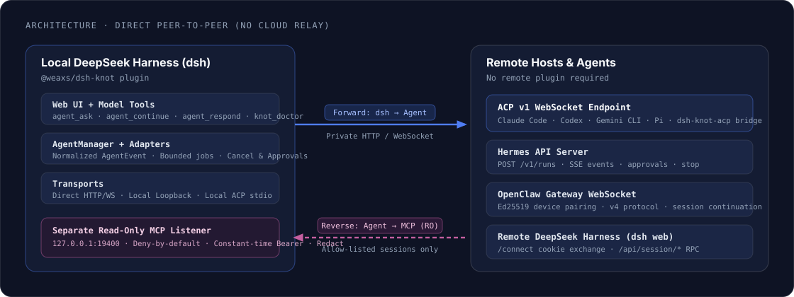

<p align="center">
  
</p>

<p align="center">
  <a href="https://github.com/Weaxs/dsh-knot/actions/workflows/ci.yml">
    
  </a>
  <a href="https://github.com/Weaxs/dsh-knot/actions/workflows/e2e.yml">
    
  </a>
  <a href="https://www.npmjs.com/package/@weaxs/dsh-knot">
    
  </a>
  = 22.13" />
  
  <a href="LICENSE">
    
  </a>
</p>

<p align="center">
  Connect <strong>DeepSeek Harness (dsh)</strong> directly with <strong>Paseo agents</strong>, including Hermes and OpenClaw, and remote <strong>dsh</strong> instances on the same host or over a private network, with a built-in dsh Web UI and read-only MCP session sharing.
</p>

---

## Highlights

| Capability              | What you get                                                                                                      |
| ----------------------- | ----------------------------------------------------------------------------------------------------------------- |
| **Paseo**               | Discover ready providers on a Paseo daemon. Paseo owns agent processes and provider compatibility.                |
| **Remote DSH**          | Connect to the native `dsh web` RPC API.                                                                          |
| **Built-in dsh Web UI** | Chat with remote agents, browse sessions, review approvals, cancel jobs, and manage read-only MCP sharing.        |
| **Read-only MCP**       | Share explicitly allow-listed local dsh sessions on a separate authenticated listener.                            |
| **Live E2E**            | Model-backed checks cover Hermes and OpenClaw via Paseo, and Remote DSH. See the [transport matrix](docs/E2E.md). |

---

## Web UI Dashboard

When loaded in `dsh web`, **dsh-knot** registers the **Remote Agents / 远端助手** sidebar entry:

<p align="center">
  
</p>

- **Approve or cancel in one click**: Remote approval prompts and active background jobs appear at the top of the panel.
- **Inspect connections**: Run `knot_doctor` across all configured agents or expand per-agent gateway checks.
- Click **Chat** on an assistant to open its conversation view. Expand **Thinking** or **Activity** when the agent reports reasoning or tool activity. Queue follow-up messages while a turn is running (queued turns execute in order after the current turn completes and can be removed before dispatch). Reopen a listed remote session to continue it. The panel displays turns observed by Knot. To display reasoning from OpenClaw, enable reasoning visibility for the session. [OpenClaw reasoning settings](https://docs.openclaw.ai/tools/thinking#reasoning-visibility-reasoning)
- **Control local sharing**: Toggle which local dsh sessions are visible over the separate read-only MCP listener.

---

## Architecture

<p align="center">
  
</p>

See [docs/DESIGN.md](docs/DESIGN.md) for protocol contracts, event normalization, and security boundaries.

---

## Install

Both npm package names ship identical builds: **`@weaxs/dsh-knot`** and **`dsh-knot`**.

### From npm inside DeepSeek Harness

```text
Plugins → Add plugin → npm → @weaxs/dsh-knot
```

### From a local checkout

```bash
git clone https://github.com/Weaxs/dsh-knot.git
cd dsh-knot
npm ci
npm run build
```

Then add the absolute repository directory through **Plugins → Add plugin** and restart dsh.

---

## Quick Start

> **Fastest path:** Prefer to let your server agent and local `dsh` agent handle installation, private networking, and verification automatically? Use the **[Connect a Remote Agent with Two Prompts](docs/TWO_PROMPT_SETUP.md)** guide — pick a network, copy Prompt 1 to the target host, and forward its handoff block with Prompt 2 to your local `dsh` agent.

1. Open **Remote Agents / 远端助手** in the left sidebar of `dsh web`.
2. Click **`+ Add Agent` / `+ 添加助手`**.
3. Select **Paseo** or **Remote DSH** and enter the daemon or gateway address.
4. For Paseo, enter a working directory and the daemon password if required, then click **Load providers** and select a provider. The directory must exist wherever the provider runs.
5. Save the connection. The panel stores settings in `$DSH_KNOT_STATE_DIR/agents.json` when set, otherwise in `$DSH_HOME/knot/agents.json` (default `~/.dsh/knot/agents.json`). The file has `0600` permissions.

Saved entries for the retired direct Hermes, OpenClaw, and ACP kinds are skipped and dropped on the next state write. Recreate them as Paseo connections. Keep a copy of the original state file if you need to roll back to a version that uses the old connection kinds.

### Paseo

Run a Paseo daemon on the machine that runs the agents. For a same-host setup, use `ws://127.0.0.1:6767/ws`. For a remote daemon, use an authenticated private WSS address or a verified encrypted private network. Install, enable, and authenticate providers in Paseo before loading the list in Knot. [Paseo setup](https://github.com/getpaseo/paseo/blob/v0.18.1/README.md) · [Paseo provider setup](https://github.com/getpaseo/paseo/blob/v0.18.1/public-docs/providers.md)

For Hermes, activate Paseo's bundled Hermes provider. For OpenClaw, add a custom ACP provider to Paseo that runs the official `openclaw acp` command. For a remote Gateway, add `--url` and `--token-file` to that provider's command in Paseo. [Paseo custom providers](https://github.com/getpaseo/paseo/blob/v0.18.1/docs/custom-providers.md) · [OpenClaw ACP setup](https://docs.openclaw.ai/cli/acp)

### Declarative configuration

```yaml
- id: knot
  name: "@weaxs/dsh-knot"
  config:
    agents:
      - id: hermes-via-paseo
        kind: paseo
        transport: local
        paseoProvider: hermes
        dshCwd: /home/agent/work
      - id: dsh-remote
        kind: dsh
        transport: direct
        host: https://dsh-host.example-tailnet.ts.net
        tokenEnv: DSH_GATEWAY_TOKEN
```

The Paseo configuration accepts a provider ID, an optional model override, and the daemon password via `token` or `tokenEnv` (default `DSH_KNOT_PASEO_PASSWORD`). The provider's own credentials and launch settings belong in Paseo.

### Verify with `knot_doctor`

Click **Test all connections** in the Web UI or ask dsh:

```text
Use knot_doctor to check every configured agent.
```

`knot_doctor` checks endpoint reachability and protocol health.

---

## Model Tools

| Tool             | Purpose                                                                           |
| ---------------- | --------------------------------------------------------------------------------- |
| `agent_list`     | List configured agents and optionally probe their health.                         |
| `agent_ask`      | Start a remote task and return a `jobId` immediately (or `wait: true`).           |
| `agent_continue` | Send a follow-up message to the same remote session.                              |
| `agent_status`   | Read streamed output, state, errors, and pending approvals.                       |
| `agent_cancel`   | Abort the local stream and cancel the remote run while preserving partial output. |
| `agent_respond`  | Answer a pending remote approval using one of its offered choices.                |
| `knot_doctor`    | Diagnose endpoint reachability and protocol health.                               |

Long tasks run in the background with bounded in-memory output and finished-job eviction. Tool cancellations (`exec.signal`) are forwarded into network calls, waits, doctor checks, and remote cancellations. When the originating dsh Agent supports `followup`, completion updates are posted back automatically.

---

## Reverse Read-Only MCP Sharing

Expose explicitly allow-listed local dsh sessions to remote agents over a **separate read-only HTTP listener** (never mounted on the dsh Web UI):

```bash
export DSH_KNOT_TOKEN='a-long-random-token'
```

```yaml
- id: knot
  name: "@weaxs/dsh-knot"
  config:
    mcp:
      enabled: true
      host: 127.0.0.1
      port: 19400
      allowSessions:
        - your-exact-dsh-session-id
```

- **Tools exposed**: `dsh_sessions_list`, `dsh_session_read`, `dsh_session_watch` (read-only).
- **Security**: Deny-by-default (`allowSessions: []` shares nothing), refuses wildcard hosts (`0.0.0.0` / `::`), constant-time Bearer verification, 1 MB body cap (`413` on overflow), 50-item JSON-RPC batch cap, and recursive circular-safe secret redaction.

For remote access, change `mcp.host` to the dsh host's Tailscale address and use its MagicDNS hostname in the remote client:

```yaml
mcp_servers:
  dsh:
    url: http://dsh-host.example-tailnet.ts.net:19400/mcp
    headers:
      Authorization: Bearer ${env:DSH_KNOT_TOKEN}
    trust: untrusted
```

---

## Transports

| Transport          | Best for                          | Notes                                                        |
| ------------------ | --------------------------------- | ------------------------------------------------------------ |
| `direct` (default) | Tailscale, Headscale, private LAN | Provide a full endpoint URL or a `host` and optional `port`. |
| `local`            | Agents on the same machine        | Defaults to `127.0.0.1`.                                     |

Credentialed connections require HTTPS or WSS outside loopback. For a verified encrypted overlay, select the encrypted private network checkbox in Remote Agents or set `encryptedOverlay: true` for the endpoint in `cordis.patch.yml`. If a saved HTTP or WebSocket connection is blocked after upgrading, edit its URL to use HTTPS or WSS, or select the checkbox after verifying the encrypted route. Ordinary private LANs require HTTPS or WSS.

---

## Development & Release

```bash
npm ci
npm run lint
npm run typecheck
npm test
npm run build
npm run check
```

- Repository rules & lessons: [AGENTS.md](AGENTS.md)
- Two-prompt agent setup guide: [docs/TWO_PROMPT_SETUP.md](docs/TWO_PROMPT_SETUP.md)
- Protocol architecture: [docs/DESIGN.md](docs/DESIGN.md)
- Live E2E matrix: [docs/E2E.md](docs/E2E.md)

Run `npm run release <semver>` to sync the package and runtime versions, then push tag `v<semver>`. GitHub Actions verifies the build, publishes both npm packages with provenance, and creates the GitHub Release. To retry an existing tag, run the **Release** workflow from `main` with that tag.

In npm, configure a GitHub Actions [trusted publisher](https://docs.npmjs.com/trusted-publishers/) for both `@weaxs/dsh-knot` and `dsh-knot`. Use owner `Weaxs`, repository `dsh-knot`, workflow `release.yml`, and enable `npm publish`.

## License

[MIT](LICENSE)
